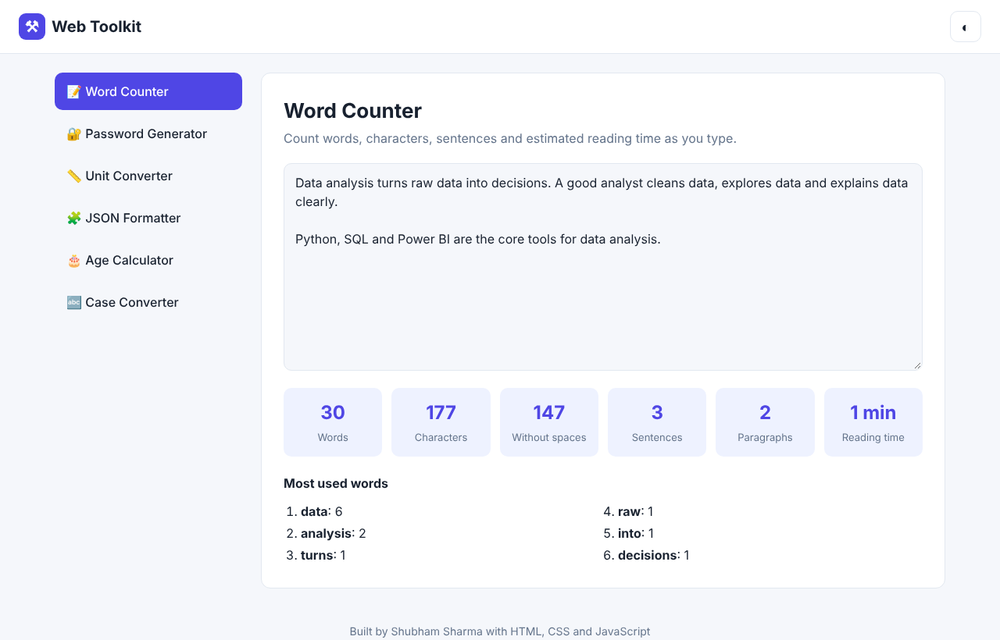
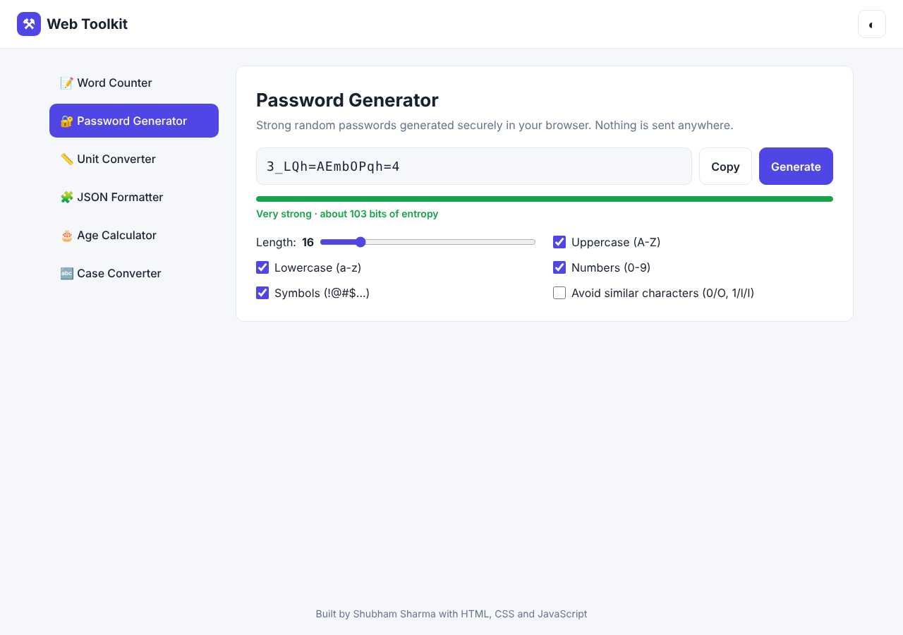
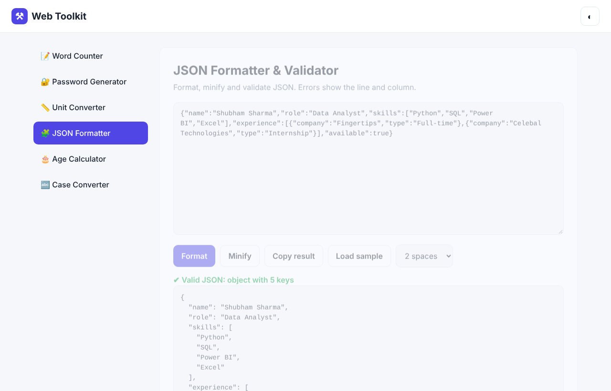

# Web Toolkit


A collection of six everyday utility tools in one fast, responsive web page, built with plain **HTML, CSS and JavaScript** (no frameworks, no libraries). Everything runs in the browser, so no data is sent to a server.


**Live demo:** https://shubhamsharma1031.github.io/web-toolkit/

## Screenshots

| Word counter | Password generator | JSON formatter |
|---|---|---|
|  |  |  |

## Tools

| Tool | What it does |
|---|---|
| 📝 **Word Counter** | Live count of words, characters, sentences, paragraphs, reading time, and the most used words (common stop words ignored) |
| 🔐 **Password Generator** | Secure passwords using `crypto.getRandomValues`, with length and character options, "avoid similar characters", and a strength meter based on entropy |
| 📏 **Unit Converter** | Length, weight, temperature, area, speed and data size, with swap button and formula |
| 🧩 **JSON Formatter** | Format, minify and validate JSON, with the error line and column |
| 🎂 **Age Calculator** | Exact age in years, months and days (handles month ends and leap years), total days and weeks, days to next birthday |
| 🔤 **Case Converter** | UPPER, lower, Title, Sentence, camelCase, PascalCase, snake_case, kebab-case |

Other features: dark mode (remembered with `localStorage`), copy-to-clipboard buttons, tab state saved in the URL (`#password` opens the password tool), and a mobile-friendly layout.

## Technical highlights

- **Secure randomness:** passwords use the Web Crypto API instead of `Math.random`, with rejection sampling to avoid modulo bias, and a Fisher–Yates shuffle so required characters are not always at the start.
- **Unit conversion design:** each unit stores one factor to a base unit, so any unit converts to any other with `value × from ÷ to`. Temperature uses formulas because it is not a simple ratio.
- **Age calculation:** counts whole months first, then the remaining days from an anchor date clamped to the end of short months (for example 31 Jan → 28 Feb).
- **Performance:** the word counter is debounced so it does not recalculate on every key press.
- **Accessibility:** buttons and inputs have labels, the toast uses `aria-live`, and the layout works with the keyboard.

## Run locally

No build step needed. Download the folder and open `index.html` in a browser, or:

```bash
# any static server works, for example
python -m http.server 8000
# then open http://localhost:8000
```

## Project structure

```
web-toolkit/
├── index.html      # layout and the six tool sections
├── css/style.css   # styles, dark mode, responsive rules
└── js/app.js       # logic for every tool
```

## Author

**Shubham Sharma** · [LinkedIn](https://www.linkedin.com/in/shubham-sharma-27aa38268) · [Portfolio](https://shubhamsharma1031.netlify.app/)
